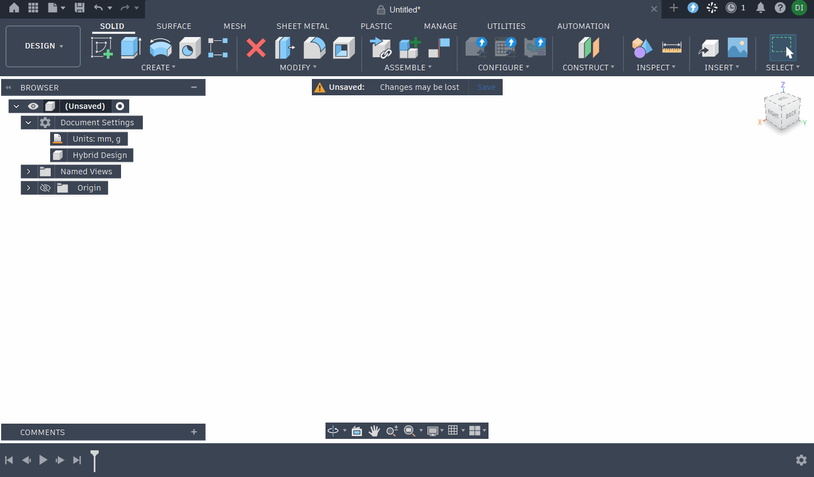

# PromptCAD

[](https://github.com/slim-gears/promptcad/actions/workflows/test.yml)
[](https://github.com/slim-gears/promptcad/releases)
[](LICENSE)

**Prompt to 100% Parametric CAD History in Autodesk Fusion 360**



<sub>*"A 90-degree pipe elbow with 30mm outer diameter, 3mm wall, swept over an 80mm radius, with an 80mm round mounting flange with 6 bolt holes on a 60mm bolt circle."*</sub>

PromptCAD is an open-source Autodesk Fusion 360 add-in that converts natural language prompts into native, fully-constrained, and fully-parametric 3D CAD history using local LLMs (via Ollama) or cloud providers (such as Google Gemini).

Unlike mesh-based generative 3D tools that produce uneditable STL/OBJ blobs, PromptCAD creates **real CAD features** in the Fusion 360 timeline: sketches, parametric dimensions, extrusions, revolves, sweeps, coils, fillets, chamfers, and user parameters you can edit anytime under `Modify > Change Parameters`.

---

## ✨ Key Features

* **Chat to Refine**: A docked chat panel keeps the whole conversation. Ask for a part, then say what to change ("make the flange thicker") and the model updates the same design.
* **Regenerate in Place**: Each chat owns one timeline group. A new version replaces the previous one in a single undoable step, and if the rebuild fails, Fusion rolls it back so your previous version stays.
* **Versions, JSON and Parameters at Hand**: Restore any earlier version, view or edit a version's JSON and build it, or tweak a parameter right in the panel without asking the model.
* **Chats Saved in Your Design**: Conversations are stored inside the Fusion document, so you can reopen a file later and keep refining it.
* **Real Parametric B-Rep History**: Builds native Fusion 360 features organized in clean timeline groups.
* **Fully Constrained Sketches**: Sketches evaluate to fully constrained (black curves, padlock icon in browser tree) with automated geometric constraints and driving dimensions.
* **Pluggable Provider Architecture**: Zero vendor lock-in. Switch seamlessly between local Ollama (Qwen 2.5 Coder, DeepSeek, Llama) and Cloud AI (Google Gemini, etc.). Adding a new provider is as simple as dropping a Python file into `providers/`.
* **Self-Healing Solver Loop**: If Fusion's CAD kernel encounters an error (e.g., self-intersecting sweep or invalid face selection), Fusion automatically rolls back the transaction, sends the exact traceback to the model, and retries.
* **Real-Time Streaming & Thought Inspection**: Watch the model's reasoning live in the panel, and stop at any time with **⏹** or **Esc**.
* **Open & Declarative JSON DSL**: Uses an inspectable, human-readable CAD timeline DSL documented in [`DSL_SPEC.md`](DSL_SPEC.md).

---

## 🚀 Installation

> PromptCAD is developed and tested on **Windows**. It should work on **macOS** too, but that hasn't been tested yet; reports are welcome.

### 1. Locate Fusion 360's Add-Ins Folder

* **Windows**:
  ```text
  %APPDATA%\Autodesk\Autodesk Fusion 360\API\AddIns
  ```
  *(e.g. `C:\Users\<Username>\AppData\Roaming\Autodesk\Autodesk Fusion 360\API\AddIns`)*

* **macOS**:
  ```text
  ~/Library/Application Support/Autodesk/Autodesk Fusion 360/API/AddIns
  ```

### 2. Download PromptCAD

1. Download `PromptCAD-<version>.zip` from the [latest release](https://github.com/slim-gears/promptcad/releases/latest).
2. Extract it into the `AddIns` folder. You should end up with `AddIns\PromptCAD\PromptCAD.py`.

To update later, close Fusion, delete the old `PromptCAD` folder and extract the new one. Your settings and chats are kept: settings live in your user folder, and chats are saved in your designs.

*Want the latest code instead?* Clone the repository into the `AddIns` folder; the folder must be named `PromptCAD`:

```bash
cd "%APPDATA%\Autodesk\Autodesk Fusion 360\API\AddIns"
git clone https://github.com/slim-gears/promptcad.git PromptCAD
```

### 3. Run in Fusion 360

1. Launch Autodesk Fusion 360.
2. Press **Shift + S** (or navigate to `Utilities` > `Add-Ins`).
3. Select the **Add-Ins** tab.
4. Locate **PromptCAD** in the list.
5. Click **Run** (check *Run on Startup* if you want it loaded automatically).
6. A **PromptCAD** button will appear in the **Solid > Create** panel on your toolbar. Click it to open the chat panel (docked on the right).

---

## 🛠 Configuration

Two places, both saved automatically:

- **Model menu** (the chip at the top right, e.g. `Gemini · gemini-2.5-flash`): pick the model you want to use, grouped by provider, with search when the list gets long. Small icons next to a model show whether it reads images (picture) or can think before answering (light bulb). For models that can think, the menu has a **Think before answering** switch, remembered per model. This is the one you'll change often.
- **Settings** (gear icon, or `Ctrl+,`): set up each provider once (server URL, API key, **Test connection**), and general options:
  - **Theme**: Match system, Light or Dark. Fusion doesn't tell add-ins which theme it uses, so pick the one that matches yours.
  - **New chats build into**: New component (default) or New body. Each chat can switch from the button under the message box.
  - **Fix failed builds automatically**: how many times PromptCAD sends a build error back to the model for a corrected design (Off to 5; default 2).

### Where your settings and logs are kept

PromptCAD keeps your settings (including API keys) and its logs in your user folder, not in the add-in folder, so updating or reinstalling the add-in never touches them:

* **Windows**: `%APPDATA%\PromptCAD`
* **macOS**: `~/Library/Application Support/PromptCAD`

| File | What it is |
|---|---|
| `settings.json` | Your settings. API keys are stored here as plain text; if you'd rather not, leave the key empty and set the provider's environment variable instead (e.g. `GEMINI_API_KEY`). |
| `promptcad.log` | A full record of each request and reply, handy for bug reports. Kept under 5 MB (one older copy is kept as `promptcad.log.old`). |
| `last_response.txt` | The model's most recent raw reply. |

**Privacy**:
* Your prompts, the chat history and, for models that use tools, details of your open design are sent to the provider you pick. With Ollama, everything stays on your computer.
* Chats are saved **inside the design**, so they travel with it: anyone you share the design or an exported `.f3d` with can read the whole conversation. Delete a chat from the title menu before sharing if you'd rather not. Earlier saved versions of the design in Fusion's version history still contain it. API keys are never stored in designs.

### Using Local Ollama (Recommended for Privacy)
1. Install [Ollama](https://ollama.ai) and pull a coding/reasoning model:
   ```bash
   ollama run qwen2.5-coder:7b
   # or for reasoning:
   ollama run qwen3.8:latest
   ```
2. In PromptCAD:
   - Open **Settings → Ollama** and set **Ollama URL** (default `http://localhost:11434`). Click **Test connection**.
   - Pick your model from the model menu.
   - For models that can reason (e.g. `qwen3`), turn on **Think before answering** in the model menu.

### Using Google Gemini
1. Obtain an API key from [Google AI Studio](https://aistudio.google.com).
2. In PromptCAD:
   - Open **Settings → Google Gemini** and paste your **Gemini API key** (or export `GEMINI_API_KEY` in your system environment).
   - Pick a model from the model menu (e.g. `gemini-2.5-flash`).

---

## 💬 Using the Chat Panel

* **Start**: describe a part, or click one of the examples. PromptCAD builds it as **v1** in a timeline group named `PromptCAD · <title> · v1`.
* **Refine**: reply with a change. The model gets the whole conversation and returns the complete updated design, which **replaces** the previous version.
* **Where it's built**: the button under the message box chooses, per chat:
  * **New component** (default): the chat gets its own component. New versions replace what's inside it, so its position, joints and appearance survive regenerating, and the design's cuts only touch its own bodies.
  * **New body**: bodies in the root component.

  The default for new chats is in **Settings → General**. Chats made before build modes existed keep building new bodies. Part Design documents hold a single component, so there everything is built as new bodies; use an Assembly document to get a component per chat.
* **Working with your own design**: the model can look at what's already in the document (components, bodies, sketches, the timeline, parameters, what you've selected, distances between things), so you can model something yourself and ask it to continue: *"add a lid that fits the selected housing"*. It only reads; what it builds is still new geometry in the chat's own component or bodies. Expand **Looked at your design** on a reply to see what it checked.
  * Models that support tools (shown in the model list) decide for themselves what to look at.
  * Other models get a short summary of the design with each message instead.
* **If something fails**: build errors are sent back to the model automatically (2 tries by default, see Settings). If it still fails, your previous version is untouched; click **Retry** or rephrase. Problems the model can't fix (such as Fusion refusing to remove the old version) are reported straight away.
* **Edit JSON**: click **JSON** on the current version, edit it (`Ctrl+Enter` to build), and it becomes the next version. Older versions open read-only with **Restore**.
* **Parameters**: expand **Parameters** above the message box and edit a value; Fusion updates immediately. The model is told about manual changes with your next message.
* **Several parts**: **+** starts a new chat (a new part alongside the others); the title menu switches between chats in this design.
* **Delete a chat**: in the title menu, point at a chat and click the trash icon. This removes the conversation and its versions from the design; the parts it built stay in your timeline as ordinary features.
* **Your own features**: if you added features after a PromptCAD part, you're asked before it's replaced.
* **Keys**: `Enter` send · `Shift+Enter` new line · `Esc` stop · `Ctrl+Shift+O` new chat.

To work on the panel's look without Fusion, serve the `palette/` folder (e.g. `python -m http.server --directory palette`) and open `index.html?mock&demo`; it runs against a built-in mock back end.

---

## 💡 Example Prompts

Paste prompts directly into PromptCAD:

* **Mounting Bracket**:
  > *"A heavy-duty mounting bracket with a 50x80mm base, 5mm thickness, 4 corner bolt holes of 6mm diameter, and a central vertical lug with a 12mm hole."*

* **Flanged Pipe Elbow**:
  > *"A 90-degree pipe elbow with 30mm outer diameter, 3mm wall, swept over an 80mm radius, with an 80mm round mounting flange with 6 bolt holes on a 60mm bolt circle."*

* **Helical Spring**:
  > *"A compression spring with 25mm outer diameter, 3mm wire diameter, 6 active turns, and 8mm pitch."*

* **Direct DSL Mode**:
  > Paste raw timeline JSON starting with `{` into the chat to build it directly without an LLM call.

---

## 🔌 Adding Custom Providers

PromptCAD uses a pluggable architecture: everything about a provider lives in its plugin, and the rest of PromptCAD doesn't know which providers exist. To add one (e.g. OpenAI, Anthropic, Groq, LM Studio):

1. Create a new file in `providers/` (e.g., `providers/openai.py`).
2. Subclass `BaseProvider`:
   ```python
   from .base import BaseProvider, GenerateOptions, ModelInfo, SettingDef

   class OpenAIProvider(BaseProvider):
       id = 'openai'
       name = 'OpenAI'
       short_name = 'OpenAI'   # optional: shown on the model chip
       order = 30              # optional: position in lists (lower first)

       def get_settings_schema(self):
           # Field types: 'string', 'secret', 'boolean', 'number' (minimum/maximum), 'select' (options)
           return [SettingDef('api_key', 'API key', 'secret', '', required=True, refreshes_models=True)]

       def list_models(self, values, timeout=5):
           # Raise with a readable message when it can't connect; it's shown on the Settings page.
           return [ModelInfo('gpt-4o', label='GPT-4o', images=True, tools=True)]

       # Optional: when is the provider ready to use? By default every required field must be filled in.
       def is_configured(self, values):
           return bool(values.get('api_key'))

       def generate(self, model, messages, values, options=None, on_chunk=None, stop_event=None, on_open=None, log=print):
           # options.think: reason first (only sent to models listed with thinking=True)
           # options.response_schema: JSON schema for the reply, if the API can enforce one
           # options.tools: ToolDefs the model may call (only for models listed with tools=True)
           # Stream chunks via on_chunk('text'|'thought', chunk); stop when stop_event is set.
           ...
           return response_text  # or Reply(text, [ToolCall(id, name, arguments), ...]) when it called tools
   ```
3. PromptCAD discovers it automatically: it gets its own page under **Settings** (built from `get_settings_schema()`), and its models show up in the model menu once it's set up.

A provider only ever receives its own `values` as a plain dictionary. Where and how they're saved is up to PromptCAD.

Messages are plain dictionaries in one format for all providers (see `providers/base.py`); a provider converts them to its API's format, including assistant messages with `tool_calls` and `tool` results. Anything the API needs back with a tool call later (such as a signature) goes in `ToolCall.extra`, which PromptCAD stores and returns untouched.

To try a provider without Fusion:

```bash
python llm.py --provider ollama --model qwen3:8b --set url=http://localhost:11434 --think "a 40 mm cube with a 10 mm hole"
```

### Adding Tools

The tools the model can call are plug-ins too, in the `tools/` folder. The current design inspection tools are one of them (`tools/design.py`), and PromptCAD itself doesn't know about any particular tool.

1. Create a file in `tools/` (e.g. `tools/my_tools.py`).
2. Subclass `BaseToolkit`:
   ```python
   from .base import BaseToolkit, ToolError

   class MyToolkit(BaseToolkit):
       id = 'my_tools'            # also the key of its saved state
       name = 'My tools'
       needs = ()                 # extra model capabilities required, e.g. ('images',)
       prompt = 'MY TOOLS\n- When to use them...'  # added to the system prompt when offered

       def tools(self):
           return [{'name': 'count_holes', 'description': 'Counts holes in the design.',
                    'parameters': {'type': 'object', 'properties': {}}}]

       def run(self, name, args, ctx):
           # ctx.app, ctx.design: Fusion (always called on the main thread)
           # ctx.state: this toolkit's own data for the document, saved by PromptCAD
           ...
           return {'holes': 4}      # raise ToolError('...') for problems the model should read

       def label(self, name, args, result):
           return f'Counted holes · {result.get("holes")}'   # the line shown in the panel

       def summary(self, ctx):
           return ''              # optional: text for models that can't call tools
   ```
3. PromptCAD discovers it automatically and offers its tools to every model that supports tool calling and has the capabilities in `needs`. If two toolkits use the same tool name, the one listed first (lower `order`) keeps it.

---

## 🧪 Testing Outside Fusion 360

PromptCAD includes a test suite that runs on standard Python without requiring Fusion 360 to be open:

```bash
python test_dsl.py
```

The tests use a temporary folder for settings and logs, so they never touch yours. They verify DSL schema validation, parametric expression evaluation, geometric constraint inference, provider plug-ins, design tools, chat history and saving, and the full chat-panel flow (replace on rebuild, rollback on failure, self-healing, restore, JSON and parameter edits) against a simulated Fusion.

---

## 🤝 Contributing

Bug reports, providers, tools and fixes are welcome. See [CONTRIBUTING.md](CONTRIBUTING.md) for how to set up, run the tests and work on the panel, and [CHANGELOG.md](CHANGELOG.md) for what changed in each version.

---

## 📄 License

PromptCAD is licensed under the [MIT License](LICENSE).

---

## ⚠️ Disclaimer

PromptCAD is an independent open-source add-in and is not affiliated with, endorsed by, or sponsored by Autodesk, Inc. or Ollama. Autodesk and Fusion 360 are registered trademarks of Autodesk, Inc.
